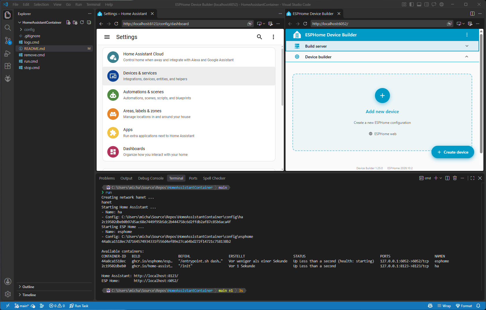

# Home Assistant Container

This repo contains batch scripts to start Home Assistant Container and ESPHome Device Builder using WSLC on Windows 11.

## Commands

Requires WSL3 with WSLC on Windows 11.

* `run` - Create and start containers `ha` and `esphome` in shared network `hanet`.
* `stop` - Stop and remove containers and network.
* `remove` - Remove configuration files in `config` folder.
* `remove /all` - Remove configuration files and prune container images.
* `logs` - Show `ha` container logs.

## Links

* [Home Assistant Container](https://www.home-assistant.io/installation/raspberrypi-other#platform-installation)
* [ESPHome Device Builder](https://github.com/esphome/esphome-desktop)
* [Running ESPHome in Docker](https://esphome.io/install/docker/)
